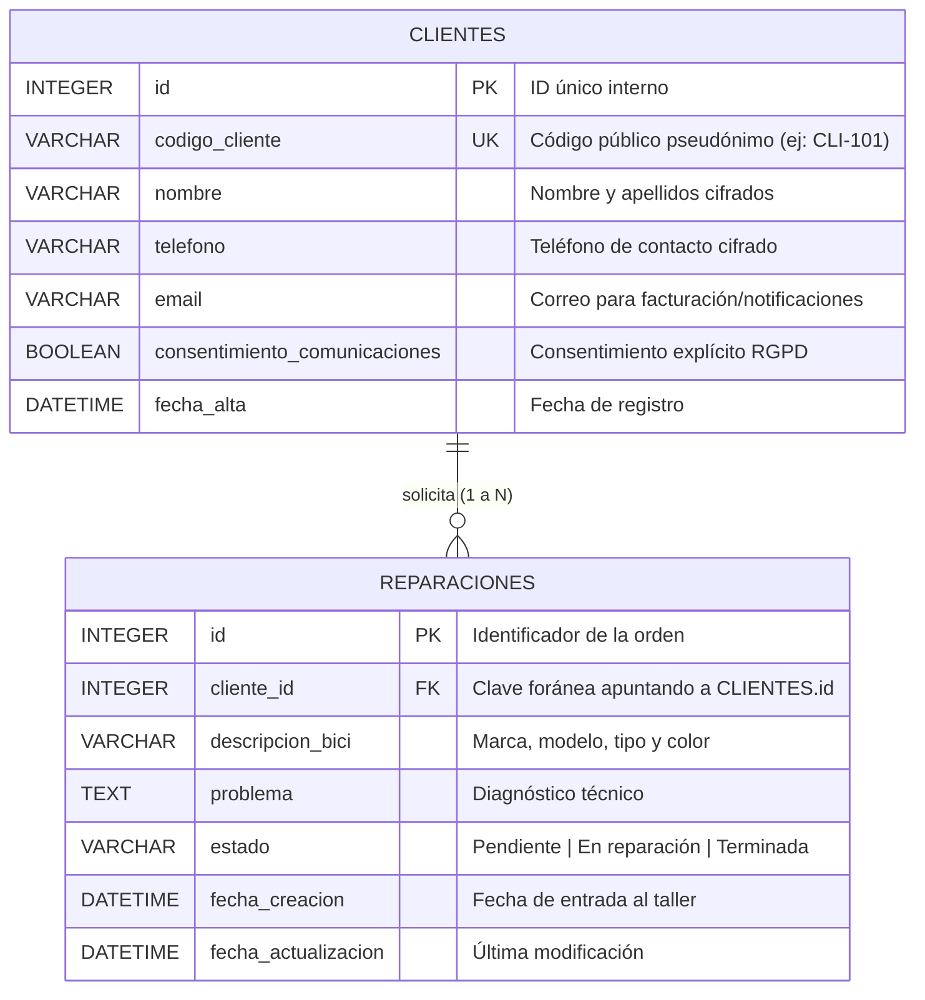

# 🚲 Gestión de Reparaciones - Taller de Bicicletas
> **Caso Práctico para el proceso de selección del programa PRET/TR3S60 en aicir**

Este proyecto es un prototipo full-stack desarrollado para dar respuesta al caso práctico de gestión de órdenes de reparación en un taller de bicicletas. Permite registrar bicicletas recibidas, diagnosticar el problema, consultar el estado de cada reparación y gestionarlo a lo largo de su ciclo de vida (**Pendiente**, **En reparación**, **Terminada**).

> 💡 **Documentación de Entrega y Arquitectura**:
> - [**PROPUESTA_MEJORAS_Y_ARQUITECTURA.md**](./PROPUESTA_MEJORAS_Y_ARQUITECTURA.md): Propuesta integral de evolución empresarial: **Ciberseguridad en profundidad (OWASP, JWT/MFA), Cifrado Asimétrico RSA-256 + AES-GCM (Envelope Encryption), Modelo RBAC/ABAC granular, Arquitectura Hexagonal y Microservicio de Notificaciones (SMS y Correo) con RabbitMQ, Normalización del Catálogo de Bicicletas (Modelo Automoción), Observabilidad y Roadmap de producción**.

---

## 📋 Requisitos del Caso Práctico Cumplidos

- [x] **Crear una orden de reparación**: Formulario estructurado con validación en tiempo real, generador de códigos de cliente y catálogo interactivo de averías frecuentes.
- [x] **Consultar las órdenes existentes**: Dashboard visual con estadísticas en tiempo real y doble modalidad de visualización (**Tablero Kanban** por etapas de trabajo y **Vista Tabla**).
- [x] **Cambiar el estado**: Selector directo en 1 clic y botón de avance rápido entre «Pendiente», «En reparación» y «Terminada» con feedback visual inmediato.
- [x] **Datos de cada orden**: Identificador (`id`), código ficticio de cliente (`codigo_cliente`, ej: `CLI-101`), descripción de la bicicleta (`descripcion_bici`), problema comunicado (`problema`) y estado de la reparación (`estado`).
- [x] **Cuidado del dato y persistencia**: Base de datos relacional local **SQLite** con restricciones de integridad (`CHECK`, `NOT NULL`, `DEFAULT CURRENT_TIMESTAMP`), capa de validación defensiva en backend y consultas preparadas (evitando inyecciones SQL).
- [x] **Preparado para Docker**: `Dockerfile` para backend y frontend con `docker-compose.yml` para arranque con un único comando.

---

## 🔒 Privacidad, Uso de IA y Modelo de Relación con Clientes

### 1. Uso exclusivo de datos inventados (Datos Sintéticos)
- **Cumplimiento estricto de privacidad**: En este prototipo se utilizan **exclusivamente datos sintéticos e inventados**. No se recopilan ni almacenan nombres reales, teléfonos reales ni ningún tipo de Información Personal Identificable (PII).
- **Convención segura**: Se utilizan identificadores pseudónimos de cliente (`CLI-001`, `CLI-002`, etc.) y números telefónicos ficticios bajo el prefijo reservado internacionalmente para ficción (`555-XXXXXX`).

---

### 2. ¿Cómo relacionaríamos las reparaciones con sus clientes en producción?

Si el producto necesitara recopilar datos reales de contacto (para avisar automáticamente al cliente por SMS/WhatsApp cuando la bici esté reparada, enviar presupuestos o emitir facturas), la arquitectura debe respetar el **Principio de Disociación y Minimización de Datos (RGPD Art. 5.1.c)**.

En lugar de incrustar el nombre y teléfono dentro de cada orden de reparación, se desacoplan en un **modelo relacional normalizado 1 a N**:



#### Ventajas clave de este diseño:
1. **Historial de Cliente y Fidelización**: Un mismo cliente (`CLI-101`) puede registrar múltiples bicicletas a lo largo del tiempo sin duplicar su información de contacto.
2. **Minimización de Superficie**: La orden física o digital que viaja al taller solo contiene el `cliente_id` / `codigo_cliente` y los datos técnicos de la bicicleta, manteniendo la información de contacto protegida.
3. **Cumplimiento de Derechos ARCO/RGPD**: Si un cliente solicita el derecho de supresión u olvido, es posible anonimizar su registro en `CLIENTES` manteniendo intactas las estadísticas y registros contables de `REPARACIONES` disociadas.

---

### 3. Matriz de Control de Acceso (RBAC): ¿Quién debe acceder a qué?

El acceso a la información debe segmentarse mediante **Control de Acceso Basado en Roles (RBAC)** con el principio de mínimo privilegio:

| Rol de Usuario                           | Datos Técnicos de Reparación (`Bicicleta`, `Avería`, `Estado`) | Datos de Contacto del Cliente (`Teléfono`, `Email`, `Nombre`) | Justificación de Negocio y Privacidad                                                                                                     |
| :--------------------------------------- | :------------------------------------------------------------: | :-----------------------------------------------------------: | :---------------------------------------------------------------------------------------------------------------------------------------- |
| **👨‍🔧 Mecánico / Operario de Taller**      |                    **Lectura y Escritura**                     |                       ❌ **Sin Acceso**                        | El mecánico solo necesita saber qué reparar y en qué caballete trabajar. Ocultar los datos personales previene filtraciones en el taller. |
| **💼 Recepción / Atención al Cliente**    |                    **Lectura y Escritura**                     |                    **Lectura y Escritura**                    | Personal encargado de recibir la bici, validar presupuestos y contactar al cliente cuando el estado pase a *«Terminada»*.                 |
| **📊 Administración / Gerencia**          |                     **Lectura (Métricas)**                     |                    ❌ **Solo Anonimizado**                     | Análisis de rendimiento (tiempos medios de reparación, volumen de averías) sin necesidad de consultar PII.                                |
| **🛡️ Delegado de Protección (DPO/Admin)** |                         **Auditoría**                          |                    **Gestión / Auditoría**                    | Tramitación de derechos RGPD, borrado de clientes y revisión de registros de acceso.                                                      |

#### Medidas de Seguridad adicionales recomendadas:
- **Cifrado**: Cifrado en reposo para campos sensibles (`AES-256` para teléfonos y emails) y en tránsito mediante HTTPS/TLS.
- **Log de Auditoría**: Registrar cada vez que un usuario de recepción visualiza o exporta datos de contacto de un cliente.


### Backend: Node.js + Express + SQLite nativo (`node:sqlite`)
- **¿Por qué SQLite?**: Para garantizar el **cuidado del dato** sin requerir que el evaluador instale motores de bases de datos externos pesados. Ofrece transaccionalidad ACID, tipos de datos y constraints reales a nivel de motor:
  ```sql
  CHECK(estado IN ('Pendiente', 'En reparación', 'Terminada'))
  ```
- **Módulo nativo `node:sqlite`**: Aprovecha el soporte nativo de SQLite introducido en Node.js (v22+), eliminando dependencias de compiladores C++ (`node-gyp`), vulnerabilidades externas y agilizando la construcción de contenedores Docker.
- **Arquitectura en Capas**:
  - `controllers/`: Manejo de peticiones HTTP y códigos de estado semánticos (`200`, `201`, `400`, `404`).
  - `validators/`: Validación defensiva estricta de payloads antes de tocar la base de datos.
  - `repositories/`: Consultas SQL parametrizadas (`?`) para máxima seguridad contra inyecciones SQL.
  - `config/database.js`: Inicialización automática de esquema y semillas iniciales de prueba (seed data).

### Frontend: React + CSS Puro / Variables CSS (Sin librerías externas)
- **UI/UX orientada al taller de bicicletas**:
  - **Tablero Kanban**: Permite al mecánico o recepcionista visualizar de un vistazo el *Work in Progress* (WIP) dividido en 3 columnas por estado.
  - **Cambio de estado ágil**: Botones de acción rápida ("Iniciar reparación", "Marcar terminada") y selectores en línea para evitar recargas o navegación innecesaria.
  - **Badges Semánticos**:
    - ⏳ **Pendiente**: Tono ámbar (espera).
    - 🔧 **En reparación**: Tono azul (en caballete).
    - ✅ **Terminada**: Tono verde (lista para entrega).
  - **Formulario de Alta Guiado**: Chips de averías frecuentes (rueda pinchada, frenos, cambios, etc.) que rellenan automáticamente el campo + asistente de sugerencia de código de cliente.
  - **Notificaciones Toast**: Confirmación flotante en cada creación o actualización de estado.

---

## 🚀 Cómo Ejecutar el Proyecto

### Opción 1: Con Docker (Recomendada)
Para levantar tanto el frontend como el backend con un único comando:

```bash
docker compose up --build
```

Una vez levantado:
- 🌐 **Frontend (Aplicación Web)**: [http://localhost:8080](http://localhost:8080)
- 📡 **Backend API**: [http://localhost:3001/api/reparaciones](http://localhost:3001/api/reparaciones)
- 🩺 **Health Check**: [http://localhost:3001/api/health](http://localhost:3001/api/health)

*(La base de datos SQLite se mantiene persistente en un volumen Docker).*

---

### Opción 2: Ejecución Local (con Node.js)

#### 1. Arrancar el Backend:
```bash
cd backend
npm install
npm start
```
El servidor backend escuchará en `http://localhost:3001`. Creará automáticamente el archivo `taller.db` y cargará 4 órdenes iniciales de prueba.

*Para ejecutar el test automático del backend:*
```bash
npm test
```

#### 2. Arrancar el Frontend:
En otra terminal:
```bash
cd frontend-bicis
npm install
npm run dev
```
La aplicación abrirá en `http://localhost:5173`.

---

## 📡 Documentación de la API REST

### `GET /api/reparaciones`
Lista las órdenes de forma **paginada** para evitar saturar el servidor y la red. Admite parámetros en query:
- `?page=1`: Número de página actual (por defecto `1`).
- `?limit=6`: Elementos por página (por defecto `6`, máximo `50` para prevenir abusos/DoS).
- `?estado=Pendiente`: Filtro por estado ('Pendiente', 'En reparación', 'Terminada').
- `?search=Trek`: Búsqueda textual por cliente, modelo o problema.

**Respuesta con metadatos de paginación:**
```json
{
  "success": true,
  "count": 4,
  "data": [ ... ],
  "pagination": {
    "page": 1,
    "limit": 6,
    "total": 4,
    "totalPages": 1,
    "hasNextPage": false,
    "hasPrevPage": false
  }
}
```

### `GET /api/reparaciones/stats`
Retorna métricas cuantitativas para el panel de control:
```json
{
  "success": true,
  "data": {
    "total": 4,
    "pendientes": 2,
    "en_reparacion": 1,
    "terminadas": 1
  }
}
```

### `GET /api/clientes`
Lista o busca clientes registrados con paginación (`?page=1&limit=5&search=...`):
```bash
curl "http://localhost:3001/api/clientes?page=1&limit=5&search=CLI-001"
```

### `POST /api/clientes`
Registra un nuevo cliente ficticio en el directorio del taller:
```json
{
  "codigo_cliente": "CLI-105",
  "nombre_cliente": "Cliente Ficticio Demo",
  "telefono_cliente": "555-010105"
}
```

### `POST /api/reparaciones`
Crea una nueva orden de reparación (indexando automáticamente el cliente si es nuevo).
**Body:**
```json
{
  "codigo_cliente": "CLI-105",
  "nombre_cliente": "Cliente Ficticio Demo",
  "telefono_cliente": "555-010105",
  "descripcion_bici": "Orbea Alma H30 (Montaña)",
  "problema": "Cadena rota y desajuste en cambio trasero",
  "estado": "Pendiente"
}
```

### `PATCH /api/reparaciones/:id/estado`
Actualiza el estado de una orden.
**Body:**
```json
{
  "estado": "En reparación"
}
```
*Validación*: Si se envía un estado distinto a `'Pendiente'`, `'En reparación'` o `'Terminada'`, la API responderá con `400 Bad Request`.

### `DELETE /api/reparaciones/:id`
Elimina la orden especificada por ID.

---

## 📂 Estructura del Repositorio

```
Prueba-aicir/
├── backend/
│   ├── src/
│   │   ├── config/database.js             # Conexión SQLite y esquema relacional
│   │   ├── controllers/reparaciones.controller.js  # Controladores HTTP REST
│   │   ├── repositories/reparaciones.repository.js # Consultas parametrizadas
│   │   ├── validators/reparaciones.validator.js    # Validación defensiva de datos
│   │   └── index.js                       # Servidor Express y rutas
│   ├── test-backend.js                    # Smoke tests automatizados
│   ├── taller.db                          # Base de datos local SQLite
│   └── Dockerfile                         # Contenedor backend (Node 22 Alpine)
├── frontend-bicis/
│   ├── src/
│   │   ├── api/reparaciones.js            # Cliente fetch adaptativo (Vite / Docker)
│   │   ├── components/
│   │   │   ├── SideBar.jsx                # Barra lateral de navegación
│   │   │   ├── StatusBadge.jsx            # Insignias semánticas de estado
│   │   │   ├── ReparacionCard.jsx         # Tarjeta interactiva con cambio de estado
│   │   │   ├── KanbanBoard.jsx            # Columnas Kanban
│   │   │   ├── ReparacionesTable.jsx      # Vista alternativa en tabla
│   │   │   └── Toast.jsx                  # Notificaciones de confirmación
│   │   ├── pages/
│   │   │   ├── Home.jsx                   # Dashboard con métricas y vistas
│   │   │   └── CrearReparacion.jsx        # Formulario de registro con chips de averías
│   │   ├── consts/reparation-states.js    # Estados canónicos
│   │   └── styles/index.css               # Sistema de diseño completo en CSS Puro
│   ├── nginx.conf                         # Proxy inverso y rutas SPA
│   └── Dockerfile                         # Contenedor multi-etapa con Nginx
├── docker-compose.yml                     # Orquestación global
├── package.json                           # Scripts de automatización raíz
└── README.md                              # Documentación del proyecto
```

---

##  Autor
Desarrollado para la prueba técnica del programa **PRET/TR3S60 en aicir**.
